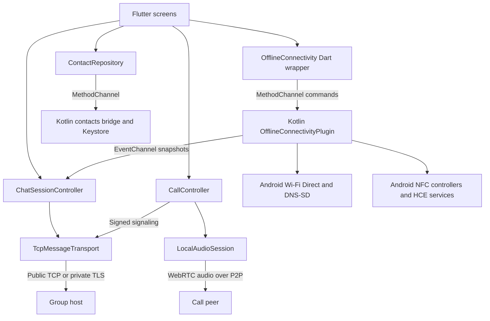
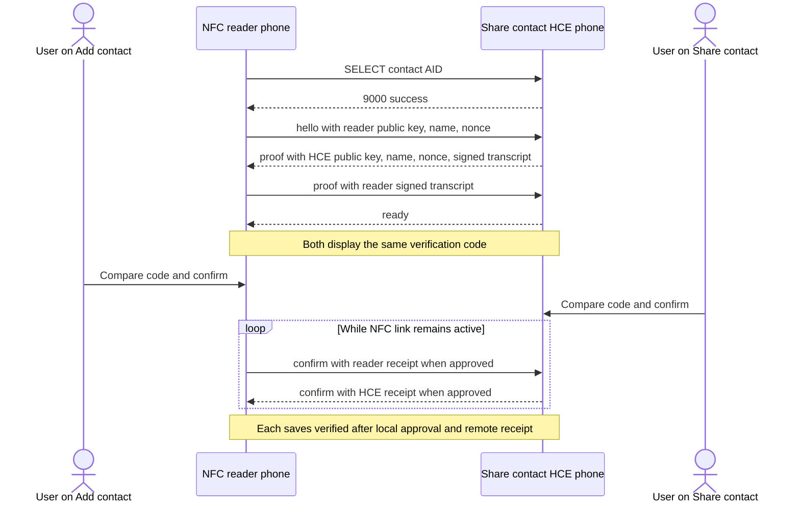
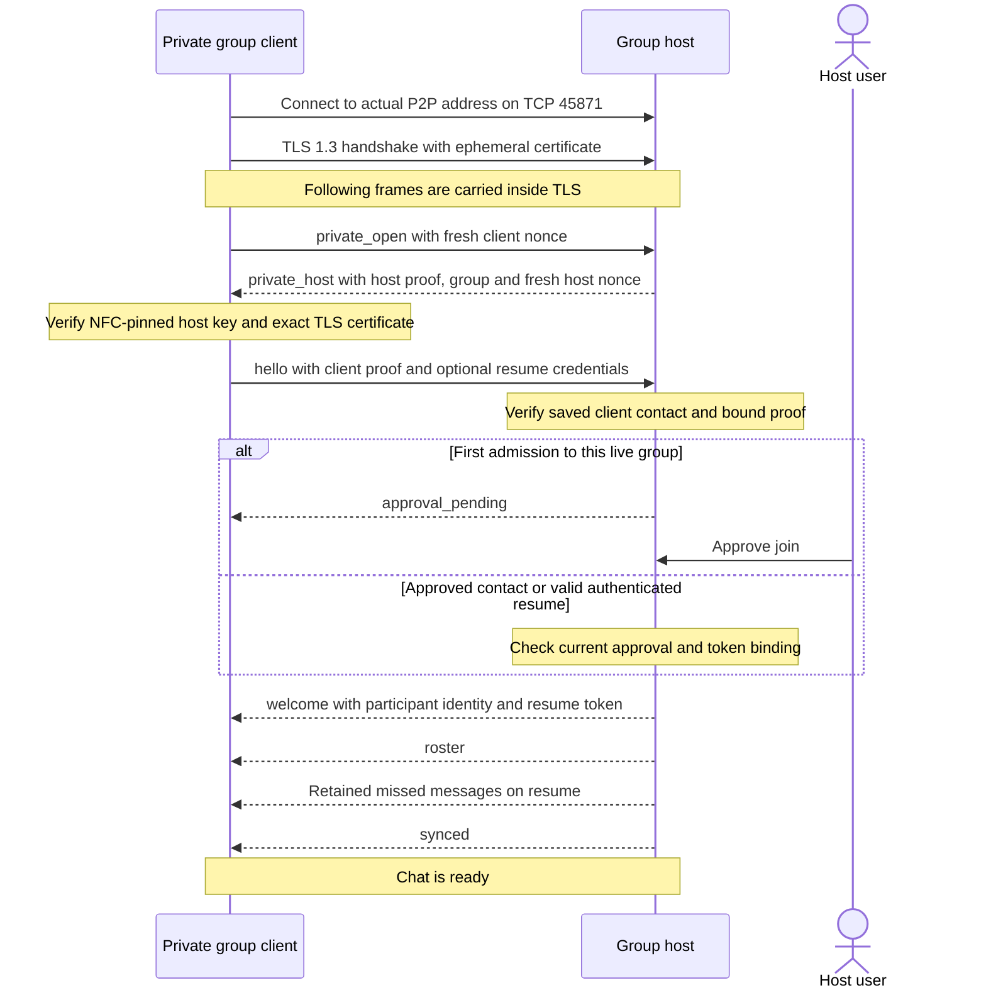

# SkyChat technologies and connection flow

SkyChat is an offline Android group messenger with a Flutter interface. Android
creates a local Wi-Fi Direct network, and Dart sockets carry chat traffic through
the phone hosting that network. NFC establishes trusted contacts. Private chat
then authenticates those contacts over TLS and asks the host to approve admission.
Voice calls use WebRTC over the same local network.

This describes the implementation as of 2026-11-24. Start with the
[source map](source-map.md) to find the files and methods behind each step.

- [Technologies and dependencies](#technologies-and-dependencies)
- [Responsibilities and network layout](#responsibilities-and-network-layout)
- [The two NFC protocols](#the-two-nfc-protocols)
- [What happens when phones touch to verify contacts](#what-happens-when-phones-touch-to-verify-contacts)
- [Creating and discovering a Wi-Fi Direct group](#creating-and-discovering-a-wi-fi-direct-group)
- [Group credentials over QR or the retained NFC invitation flow](#group-credentials-over-qr-or-the-retained-nfc-invitation-flow)
- [Private chat authentication and host approval](#private-chat-authentication-and-host-approval)
- [Chat setup and message delivery](#chat-setup-and-message-delivery)
- [Disconnection and recovery](#disconnection-and-recovery)
- [Voice calls on the existing network](#voice-calls-on-the-existing-network)
- [Platform permissions and background behavior](#platform-permissions-and-background-behavior)
- [Stored data and implementation boundaries](#stored-data-and-implementation-boundaries)

## Technologies and dependencies

Versions below come from the repository manifests and lockfile; they describe
this project rather than the latest available releases.

| Area | Technology or library | How SkyChat uses it |
| --- | --- | --- |
| Interface and application state | Flutter, Dart, Material 3, `ChangeNotifier` | Screens, navigation, themes, chat state, contacts UI and call state. Root requirements are Flutter `>=3.35.0` and Dart `^3.9.0`. |
| Android integration | Kotlin, two local Flutter plugins | `offline_connectivity` owns connection setup, NFC and contact security; `offline_audio` observes the existing network for media. |
| Flutter to native calls | Flutter `MethodChannel` and `EventChannel` | Typed Dart wrappers call Kotlin methods; native snapshots report Wi-Fi Direct state. |
| Wi-Fi Direct | Android SDK `WifiP2pManager`, `WifiP2pConfig`, `WifiP2pInfo`, `WifiP2pGroup` | Creates, joins, inspects and removes groups. The implementation is in the project's own plugin; no third-party Wi-Fi Direct Flutter package is used. |
| Nearby group discovery | Android SDK `WifiP2pDnsSdServiceInfo` and `WifiP2pDnsSdServiceRequest` | Advertises and finds application-specific DNS-SD records over Wi-Fi P2P. No Internet DNS server is involved. |
| NFC | Android SDK `NfcAdapter`, `IsoDep`, `HostApduService`, `CardEmulation` | One phone reads while the other emulates a card. Custom APDU protocols exchange contacts or group invitations. No third-party NFC package or Android Beam is used. |
| QR rendering | `qr_flutter` 4.1.0 | Renders public group credentials as a QR code. |
| QR scanning | `mobile_scanner` 7.1.4 | Reads QR codes. Android is configured to bundle the scanner model so first use works offline. |
| Chat transport | Dart SDK `dart:io`, `dart:convert`, `dart:async` | TCP server/client sockets, newline-delimited JSON, synchronization, retries and receipts. |
| Private chat encryption | Dart SDK `SecureSocket`, `SecurityContext` | TLS 1.3 between each client and the group host. |
| Contact and call signatures | Nimbus JOSE JWT `com.nimbusds:nimbus-jose-jwt:10.10` | Compact JWS with ES256 signatures, backed by Android's cryptographic APIs. No JWT login server is involved. |
| TLS certificate generation | Bouncy Castle `org.bouncycastle:bcpkix-jdk18on:1.87` | Generates an ephemeral self-signed certificate for private chat. Dart still implements the TLS connection. |
| Persistent contact security | Android Keystore, JCA, `AES/GCM/NoPadding`, `AtomicFile` | Keeps identity/store keys in Keystore and encrypts the local contact book. |
| Dart hashing | `crypto` 3.0.8 resolved from `^3.0.6` | Computes SHA-256 of the TLS certificate for contact authentication. |
| Voice media | `flutter_webrtc` 1.6.3; native `io.github.webrtc-sdk:android:150.7871.04` | Captures microphone audio, exchanges SDP/ICE and carries media with WebRTC. The local audio plugin enables Wi-Fi Direct network observation. |
| Background chat support | Android `Service` and notification APIs | An app-owned foreground service shows connection status and message notifications. |
| iOS client | Swift, Core NFC, CryptoKit, Keychain and Hotspot Configuration | Prototype reads Android NFC contacts in two taps and joins an Android-hosted chat by NFC invitation; no iPhone hosting, discovery or calling. macOS build and physical acceptance remain required; see [iPhone prototype](ios-prototype.md). |
| Build and checks | Gradle, Android Gradle Plugin 9.1.1, Kotlin 2.1.0, Flutter tests, JUnit 4.13.2 | Both local Android plugins compile against SDK 36, declare minimum SDK 24 and use Java/JVM target 11. |

Dependency declarations are in [pubspec.yaml](../pubspec.yaml),
[pubspec.lock](../pubspec.lock), the
[connectivity build file](../packages/offline_connectivity/android/build.gradle)
and the [audio package](../packages/offline_audio/pubspec.yaml) with its
[Android build file](../packages/offline_audio/android/build.gradle).
The bundled scanner setting is in [android/gradle.properties](../android/gradle.properties).

## Responsibilities and network layout

The Flutter screens delegate to controllers and repositories. The native plugin
controls Android radios and contact keys. Chat sockets stay in Dart; they are
not implemented inside the Wi-Fi Direct plugin.



The native event reaches `HomeScreen`, which passes it to
`ChatSessionController.updateConnection`. The diagram abbreviates that forwarding.

The phone that creates a group becomes the Wi-Fi Direct **Group Owner**, also
called the host. Other phones connect as clients. The same host runs the chat
server on TCP port **45871**, bound to its actual P2P address. Android supplies
that address; SkyChat does not assume a fixed subnet or hard-code
`192.168.49.1`.

Each client has one connection to the host. When client A sends a message, the
host accepts it and broadcasts it to the connected clients, including A. A
message for client B therefore follows `A -> host -> B`. This is a star topology;
there is no mesh forwarding or host migration.

Internet access, a router, cloud accounts and a backend server are unnecessary
for these exchanges. The Android `INTERNET` permission is still declared because
the app opens network sockets, including local sockets.

## The two NFC protocols

Both protocols use ISO-DEP: an NFC reader sends APDU commands and an Android
Host Card Emulation service answers. APDU means the small command/response unit
used on this link. The **AID** is the application identifier in the reader's
SELECT command; Android uses it to select the corresponding HCE service.

The NFC reader and HCE roles apply only to the tap. The phone sharing a contact
does not thereby become a Wi-Fi Direct host.

| Property | Trusted contact pairing | Group credential invitation |
| --- | --- | --- |
| Purpose | Save and verify the other person's identity for later private groups and calls. | Obtain credentials for an already hosted Wi-Fi Direct network. |
| Current entry point | Contacts tab: **Share contact** on one phone and **Add contact** on the other. | `NfcInvitationScreen` and plugin APIs remain implemented, but `HomeScreen` currently has no route that opens this screen. |
| HCE service | `NfcContactService` | `NfcInvitationService` |
| AID | `F04F46464C494E4502` | `F04F46464C494E4501` |
| Application data | Public identity keys, names, nonces, signatures and approval receipts. | Wi-Fi SSID and passphrase; a legacy private schema also has an admission token. |
| Maximum application payload | 8192 bytes per request or response. | 2048 bytes for the invitation. |
| APDU data chunk | Up to 200 bytes. | Up to 200 bytes. |
| Session timing | Up to 60 seconds for pairing. | Sharing up to 60 seconds; reading up to 30 seconds. |
| Result | Persistent verified contact after both users approve and receipts arrive. | A validated `GroupInvitation`; joining is a separate operation. |

The current Groups UI uses nearby discovery or public QR invitations. Some older
documents and strings describe private groups as NFC-invitation-only. Current
private groups instead use NFC contact verification once, then anonymous discovery,
TLS contact authentication and host approval. The legacy invitation schema does
not replace those checks.

## What happens when phones touch to verify contacts

### Preparing the phones

1. Both users open **Contacts** with NFC enabled and their phones unlocked.
2. One selects **Share contact**. `ContactPairingScreen` calls
   `ContactRepository.startPairing(name, reader: false)`. Kotlin registers
   `NfcContactService` as the preferred foreground HCE service.
3. The other selects **Add contact**, using `reader: true`. Kotlin enables
   reader mode with `FLAG_READER_NFC_A | FLAG_READER_SKIP_NDEF_CHECK`.
4. Both sides open their local `ContactVault` and create a `ContactPairing`
   session with a fresh random 32-byte nonce. Identity keys persist across
   pairings; the nonce belongs to this pairing attempt.

The private identity key is P-256 and stays in Android Keystore. The public key
is exported as base64url-encoded X.509 SubjectPublicKeyInfo DER. A contact ID is
the lowercase hexadecimal SHA-256 fingerprint of that public key DER. Names are
display labels; the key fingerprint identifies the contact.

### Exchanging identities and proving key possession

When the NFC antennas are close enough, the reader obtains an `IsoDep` link and
sends SELECT for the contact AID. The actual application exchange is:



The first request has this shape; placeholders represent generated values:

```json
{
  "type": "hello",
  "identity": {
    "key": "<base64url public key DER>",
    "name": "Alice",
    "nonce": "<base64url random 32 bytes>"
  }
}
```

The HCE reply is `{"type":"proof","identity":{...},"proof":"<compact JWS>"}`.
The reader verifies it with the received public key and answers
`{"type":"proof","proof":"<compact JWS>"}`. After checking that signature,
the HCE phone returns `{"type":"ready"}`.

Each side hashes the same role-ordered transcript. Its fields are
`ogm-nfc-contact-v1`, reader key/name/nonce, then HCE key/name/nonce. The code
serializes those fields inside a `fields` array and computes SHA-256. The
verification code shown to users is the first 32 hexadecimal characters, grouped
into eight groups of four.

Possession proofs are ES256 compact JWS tokens with header type
`ogm-contact-v1`. Their payload is:

```json
{
  "kind": "proof",
  "transcript": "<64 hexadecimal characters>",
  "role": "reader"
}
```

The HCE side uses `role: "host"` in this NFC protocol. Binding the keys, names,
nonces and roles to the transcript prevents a proof being silently substituted
from a different pairing session. Both users must still compare the displayed
code and confirm the person they intend to trust.

### Exchanging user confirmations and saving trust

After a valid possession proof, the contact is `pending`. Pressing confirm calls
`pairingApprove`, records local approval and signs a second token with
`kind: "confirm"`. The reader repeatedly exchanges
`{"type":"confirm","receipt":null}` or a signed receipt once approved. A
phone marks the contact `verified` only after its user approved and it received
the peer's valid confirmation receipt.

Keep the phones together until **both** display that the contact is verified and
saved. The native reader polls confirmations about every 300 ms, while the
Flutter screen polls local status every 500 ms. Separating the phones early can
leave an incomplete pairing on one side. An interrupted repeat pairing does not
downgrade an already verified contact.

Contact requests use APDU instruction `0x10` to allocate a bounded request,
`0x20` to write consecutive chunks, `0x30` to execute it and obtain the response
length, and `0xB0` to read response chunks. Successful replies end in `9000`.
The contact protocol returns `6985` when a command or session is invalid.

The exchanged data is public identity information and signed proofs. This tap
does not exchange Wi-Fi credentials, private identity keys, chat messages or
group membership. Pairing alone does not create or join a Wi-Fi Direct network.
Signatures bind the exchanged data to the keys; they do not encrypt the NFC
identity payload.

### Persistence and cancellation

`ContactBook` owns pending, verified and blocked records. `ContactVault` encrypts
them in `contacts-v1.enc` under Android's `noBackupFilesDir`, using AES-256-GCM,
a 12-byte IV and authenticated context `ogm-contact-store-v1`. `AtomicFile`
protects replacement of the file. The store key and signing key have separate
Android Keystore aliases. Keystore is used without a hardware-backing or StrongBox
requirement in this implementation.

The pairing stops on cancellation, activity pause/detach, timeout or link failure.
Starting contact pairing cancels invitation sharing/reading, and starting an
invitation session cancels contact pairing. Blocking prevents new authentication;
deleting a blocked contact allows a fresh NFC enrollment. Reset deletes the
contact store and its Keystore keys, creating a new identity when reopened.

## Creating and discovering a Wi-Fi Direct group

### Creating the network

1. The user chooses public or private in the Groups UI. Before requesting the
   network, `ChatSessionController.configureGroup` starts a new conversation and
   configures private contact authentication when applicable.
2. `OfflineConnectivity.createGroup` calls the Kotlin plugin through the
   connectivity method channel.
3. Kotlin checks capability, command concurrency, permissions, Wi-Fi and system
   Location. This implementation checks Location even on recent Android versions;
   an Internet connection or GPS fix is unnecessary.
4. The plugin stops its discovery operation before issuing group creation.
5. On Android 10/API 29 and later, `OfflineGroupCredentials.create` generates a
   fresh SSID shaped like `DIRECT-ab-OGM-01234567` and a random 32-character hex
   passphrase. `WifiP2pConfig.Builder` requests the 2.4 GHz band and disables
   persistent group creation. This applies to both public and private groups.
   Older Android versions use the legacy `WifiP2pManager.createGroup` overload.
6. The action callback acknowledges Android accepted the request. It does not
   prove that a usable network exists. Broadcasts and one-second connection-info
   polling inspect the actual group state.
7. Once `WifiP2pInfo.groupFormed` is true and the owner address is available, the
   plugin emits `status: "connected"`, `isHost: true` and `hostAddress`. If Android
   omits the host address, the host can recover it from the actual P2P interface.
8. Flutter passes that snapshot to the chat controller, which starts the server
   bound to `hostAddress:45871`.

### Advertising and finding groups

`PublicGroupDiscovery`, despite its historical name, advertises both public and
private groups. It registers `OfflineMessenger._ogm._tcp.local` with Android's
Wi-Fi P2P DNS-SD APIs. The app adds an advertisement revision to these fields:

| TXT field | Public group | Private group |
| --- | --- | --- |
| `app` | `offline-group-messenger` | `offline-group-messenger` |
| `v` | `3` | `4` |
| `mode` | `public` | `private` |
| `name` | Saved host username when available. | Omitted. |
| `sid` | Omitted. | Random 32-character hexadecimal label for the advertised group. |
| `advertisement` | Local advertisement revision. | Local advertisement revision. |

Neither advertisement contains the network passphrase, admission tokens or
contact keys. Current private records also omit the username and stable contact
fingerprint. The discovery `sid` is separate from the chat `groupId` generated
later by the transport.

**Find nearby groups** calls `discoverPeers`, which actually performs app service
discovery. `ServiceDiscoverySetup` serializes P2P activation, stopping the bootstrap
scan, clearing requests, adding the service request and starting service discovery.
It retries Android BUSY responses. Search runs up to four 12-second cycles,
starting with a targeted request and then broader DNS-SD requests. Only matching
app records enter the UI; generic nearby Wi-Fi devices do not.

Entries expire after 60 seconds without a refresh, checked every five seconds.
A private entry appears as `Private group <first six sid characters>`. A public
entry can show the host's advertised username. Names and radio addresses are
untrusted discovery hints, not proof of identity.

### Joining from the nearby list

`HomeScreen` calls `prepareNearbyJoin` and `joinGroup(peer.id)`. The selected
`peer.id` is the Android discovery address, used to reach the phone rather than
as its application identity. `PeerPresenceGate` rechecks Android's peer table,
refreshing discovery for up to eight seconds if necessary.

The plugin invokes `WifiP2pManager.connect` with that address, WPS push-button
configuration (`WpsInfo.PBC`) and `groupOwnerIntent=0`, preferring to join the
existing owner. Android performs network negotiation and may show a system
invitation. The app does not copy an SSID/password through NFC on this route.

As with creation, the app waits for actual `groupFormed` and `hostAddress` before
starting chat. The client then connects to the reported host on port 45871.
Being connected to Wi-Fi is distinct from being admitted to private chat.

## Group credentials over QR or the retained NFC invitation flow

For a public group, **Show QR** calls `getInvitation`. The host obtains the
current `WifiP2pGroup.networkName` and `passphrase` only on this explicit request.
`qr_flutter` displays their JSON representation; `mobile_scanner` reads it.

The retained NFC invitation implementation uses the same payload:

```json
{
  "app": "offline-group-messenger",
  "version": 1,
  "transport": "wifi-direct",
  "networkName": "DIRECT-ab-OGM-01234567",
  "passphrase": "0123456789abcdef0123456789abcdef"
}
```

These example credentials are fictitious. Real credentials are fetched from
Android. They do not appear in the connectivity event stream or DNS-SD records.

When `NfcInvitationScreen` is invoked by a caller, the sharing side calls
`startNfcSharing` and exposes the serialized payload through `NfcInvitationService`.
The other phone calls `readNfcInvitation` and uses ISO-DEP:

1. SELECT the invitation AID. The response contains a two-byte big-endian payload
   length followed by success status `9000`.
2. Issue READ BINARY commands, `00 B0 <offset high> <offset low> <length>`, to
   fetch at most 200 bytes at a time.
3. Validate each response status, decode strict UTF-8 and return the JSON string
   to Dart. The whole payload must be at most 2048 bytes.
4. Parse a `GroupInvitation`. The screen returns it to its caller without joining.

`HomeScreen._confirmInvitation`, currently reached from QR scanning, asks the
user to confirm before `joinInvitation`. An NFC screen caller must similarly
pass its result through confirmation. The native join validates the schema again
and uses `WifiP2pConfig.Builder.setNetworkName(...).setPassphrase(...)` on API 29+.
The subsequent connection-state and socket flow is the same as nearby joining.

SSID validation requires a `DIRECT-` prefix followed by two alphanumeric
characters, no control characters and at most 32 UTF-8 bytes. Passphrases must be
8 to 63 printable ASCII characters. Dart rejects raw invitations over 2048
characters; native NFC additionally enforces its byte limit. The scanner rejects
private invitations.

Legacy private invitations use schema version 2 with `privateGroup: true` and a
64-character lowercase hexadecimal `admissionToken`. Those fields remain in
bridge models and tests. Current private group creation sets no admission token
and uses contact authentication and approval instead. Do not implement a new
private join path by treating this legacy token as sufficient authority.

Invitation sharing is explicit, temporary and available only while unlocked.
Stopping sharing removes the in-memory NFC payload but does not revoke Wi-Fi
credentials already read. The group invitation protocol has no signed contact
proof, one-time credential guarantee or persistent trust enrollment.

## Private chat authentication and host approval

Private group creation sets `requireVerifiedContact` on the host, and private
joining sets `requireContactAuth` on the client. The host creates an ephemeral
P-256 TLS key and self-signed certificate through `PrivateChannelCertificate`.
This temporary software key is returned to Dart for `SecurityContext`; it is
separate from the persistent identity key, which never leaves Keystore.



The client provisionally accepts the self-signed certificate so it can request
a host proof. It does not send its application identity or resume token before
verifying that proof with a saved, verified NFC contact key. The proof binds:

- Scope `ogm-private-channel-v1` and role `host` or `client`.
- The signing contact's ID; client proofs also identify the intended host.
- The verifier's fresh 256-bit challenge.
- SHA-256 of the exact TLS certificate.
- The chat group ID.

The client pins the verified host for later resumes of that conversation. The
host independently verifies the client's proof and looks up the saved contact
name. Discovery labels are never used as authentication.

For first admission, `approval_pending` exposes no roster, chat history or resume
token. The host chooses **Approve join** or **Decline join** in Home or Chat.
Requests expire after 60 seconds. Approval is for this contact in this live group;
a newly hosted chat starts with no approvals. Resume requires both a fresh
contact proof and a valid token belonging to the same contact and group.

Private frames remain inside TLS, including messages, names, membership decisions,
receipts, resume tokens and call signaling. There is no plaintext fallback.
Encryption is between each client and the host: the host can read and forward
group text. This does not provide group end-to-end encryption between clients.
Public chat uses plaintext TCP, with self-reported names and contact IDs; those
IDs alone do not authenticate a public participant.

Removing a private member revokes its application identity, approval and resume
credentials and closes its chat connection. It does not remove that phone from
the Wi-Fi network. A later fresh admission needs host approval again. A blocked
or deleted contact cannot pass the contact verifier on a new connection.
See [private group security](private-group-security.md) for the security boundary
and acceptance scenarios.

## Chat setup and message delivery

### Establishing a chat session

All application frames are UTF-8 JSON followed by a single LF and include
`"v":3`. TCP reads can split or combine frames, so the transport buffers bytes
until LF. It rejects malformed frames, unsupported versions and frames exceeding
32768 bytes.

Public clients send `hello` immediately. Private clients send it after the host
proof, including their client authentication proof. Relevant handshake frames are:

| Frame | Direction | Data and effect |
| --- | --- | --- |
| `hello` | Client to host | Display `name`, `calls` capability, last received sequence `after`, optional `contactId`; resumption adds `groupId` and `token`; private authentication adds `contactAuth`. |
| `welcome` | Host to admitted client | `selfId`, `hostId`, `groupId`, resume `token`, synchronization `baseline`, `gap`, `lastRequest` and call capability. |
| `roster` | Host to clients | Current participants, names, contact IDs and call capability, plus a membership notice. |
| `message` | Host to resuming client | Retained messages after the resume baseline. First joins start at the current host sequence and receive no earlier history. |
| `synced` | Host to client | `through` identifies the completed synchronization cursor. Sending becomes available after welcome, roster and synchronization. |

The random participant ID and resume token belong to this hosted conversation.
They are different from the persistent contact ID. The host uses the contact ID
to deduplicate returning contact participants, while private connections also
prove possession of that contact's key. `lastRequest` lets a returning client
continue above the host's accepted request counter.

### Sending one message

1. `ChatScreen` updates the controller's draft. Send creates a request with a
   positive increasing decimal ID and retains it in the local outbox.
2. A client sends `{"v":3,"type":"send","id":"1","text":"Hello"}` to
   the host. The host derives the sender from the socket's admitted identity.
3. The host validates the request, assigns canonical ID `senderId:requestId`,
   a UTC timestamp and a monotonically increasing group sequence, and records it.
4. The host snapshots the currently connected recipients, excluding the sender,
   and broadcasts the canonical `message` frame. A host user's send goes through
   the same acceptance logic without a client-to-host socket hop.
5. The sender's broadcast echo confirms host acceptance and reconciles its
   outbox. Receiving clients record the message and send `received` with its
   canonical ID and sequence.
6. The host validates receipts against their socket identities and sends
   `delivery` snapshots only to the original sender. A host sender uses local state.

One check means host acceptance; two means at least one other client acknowledged
receipt; three means all targeted recipients, including the host when applicable,
received it. With only a host and one client, delivery can move directly from one
to three checks. A host sending alone remains at one. These are application
receipt acknowledgements, not read receipts or durable storage acknowledgements.

Retrying the same ID with the same text returns the original acceptance without
another broadcast. Reusing an accepted ID with different text is rejected. If the
old acceptance has expired from the bounded cache, the host rejects the old
counter rather than risk duplicating a message. This is not an unlimited
exactly-once guarantee.

## Disconnection and recovery

Native connection states are `idle`, `discovering`, `connecting`, `connected`,
`disconnecting` and `unavailable`. Chat separately reports `offline`, `connecting`
or `ready`. A Wi-Fi connected state does not imply that TLS, admission and chat
synchronization are complete.

On client network loss, the controller closes sockets but retains conversation
state. A restored native connected snapshot attempts chat resumption. If only
TCP failed while the network remains connected, **Retry chat** starts the socket
handshake again. Explicit client Disconnect pauses attempts but retains the local
conversation; selecting the same remembered nearby peer and mode can resume it.

Resume sends the group ID, token and last received sequence. Private resume also
repeats TLS contact authentication. The host replays retained missed messages and
delivery state. When the cursor predates retained history, `gap: true` warns that
some messages are unavailable. Uncertain sends retain their original IDs and
require explicit retry; reconnecting does not silently resend drafts.

If the host restarts, its previous group ID, approvals and tokens are gone. A
changed host session ends the old conversation. Starting a new chat explicitly
clears history, drafts and outbox. Changing Wi-Fi ownership does not migrate chat.

| Limit or deadline | Current implementation |
| --- | --- |
| Native create/join action callback | 15 seconds. |
| Native create/join setup | Independent 75-second overall deadline, with one-second state polling. |
| Discovery request | Four 12-second cycles; plugin command fallback deadline is 55 seconds. |
| Public TCP connect | Up to five attempts, two-second connect timeout and 500 ms between failures. |
| Private TLS client connect | Up to five attempts, four-second connect timeout and 500 ms between failures. |
| Host TLS handshake | Five-second timeout. |
| Unadmitted socket handshake | Eight seconds, excluding a registered pending admission. |
| Client initial synchronization | 12 seconds, excluding waiting for host approval. |
| Host message confirmation | Six seconds by default. |
| Heartbeat and dead socket | Ping every 10 seconds; 35 seconds without incoming bytes closes the socket. |
| Private host approval | 60 seconds. |
| Connected participants | Up to 15 client sockets plus the host; actual radio capacity can be lower. |
| Issued resume identities | Up to 128 per hosted session. |
| History for replay | Last 500 accepted text messages. |
| Accepted request and delivery cache | Last 1000 accepted messages. |
| Local display and outbox | Up to 500 messages/notices and 50 unconfirmed outgoing entries. |
| Message text | Up to 2000 Dart UTF-16 code units. |

The current 75-second setup, eight-second handshake and 12-second synchronization
deadlines are defined in code; some earlier milestone documents list older values.

## Voice calls on the existing network

`CallController` uses the current chat connection for directed signaling. Peers
advertise `calls: 1`, then prove live presence with signed challenge exchanges
using their NFC-pinned contact keys. Signatures bind contact and participant IDs,
group, connection nonces, sequence numbers, call ID and message contents.

The caller sends an invite without opening its microphone. The recipient accepts
before media starts. `LocalAudioSession` then captures audio through
`flutter_webrtc`, creates the peer connection and exchanges signed SDP offers,
answers and ICE candidates through the chat transport. Private groups encrypt
that signaling inside TLS; public groups carry signed signaling over plaintext
TCP. Signaling is not added to chat history or replay.

Media packets follow the WebRTC connection over the local P2P network, outside
the TCP message queue. There are no STUN or TURN servers: `iceServers` is empty.
`P2pObserver` reads the actual interface address and prefix, and candidate filters
allow UDP host candidates on that interface/subnet. Inline SDP candidates are
removed so they cannot bypass filtering. WebRTC media uses DTLS-SRTP.

The integrated app enables host-to-client calls in either direction. Calls
between clients remain gated. There is one active call per phone, and ending a call
releases media without removing the Wi-Fi Direct group. Backgrounding ends calls
and clears verified call presence; foreground return renews it.

## Platform permissions and background behavior

| Requirement | Where it is handled |
| --- | --- |
| Wi-Fi Direct hardware | `FEATURE_WIFI_DIRECT` capability check in the connectivity plugin. |
| Android 13/API 33 and later | Runtime `NEARBY_WIFI_DEVICES`; declared with `neverForLocation`. |
| Older Android | Runtime fine Location, requested together with coarse Location. |
| System Location switch | Checked by the plugin before connection/discovery commands. |
| Credential-based QR/NFC joining | Android 10/API 29 or later; nearby discovery joining uses the older API. |
| NFC sharing | NFC HCE support, NFC enabled, foreground activity and unlocked interactive device. |
| NFC reader | NFC support and foreground reader mode; invitation network joining also needs API 29+. |
| QR scanner | Camera permission, handled through the scanner package. |
| Calling | Microphone permission and audio settings declarations in the audio plugin manifest. |
| Notifications | Android 13+ runtime `POST_NOTIFICATIONS` through `MainActivity`. |

`HomeScreen` starts `SkyChatBackgroundService` when the network is connected and
uses it for an ongoing connection notification. Received messages can trigger
notifications when the app is backgrounded or the chat screen is closed. The
service is declared as `remoteMessaging` and uses `START_STICKY`.

Sockets and chat controllers remain in the Flutter process. The service does
not own an independent chat engine or restore history after process death. NFC
sessions require the foreground, and calls explicitly stop when backgrounded.
Physical-device lifecycle and radio behavior require separate acceptance testing.

## Stored data and implementation boundaries

| Data | Lifetime and location |
| --- | --- |
| Username | Android `skychat_prefs` SharedPreferences through the background channel. |
| Contact identity private key and store encryption key | Android Keystore until reset or app data loss. |
| Contact public keys, names and trust state | Encrypted `noBackupFilesDir/contacts-v1.enc`; survive app restart. |
| Wi-Fi invitation payload | Process memory during explicit sharing/reading; not written by the invitation implementation. |
| Chat history, drafts, outbox, counters and resume tokens | Process memory for the current conversation. |
| Private group approvals and pending requests | Host process memory for the current live group. |
| Private TLS key and certificate | Host process memory for the current hosted chat. |
| Voice | Live media; the app has no audio recording path. |

BLE/GATT code exists in the separate Transport Lab. It is a feasibility probe,
not the app's contact enrollment, group discovery or message transport. The lab
also has its own signaling server on port 45872; production calls use the chat
transport on 45871 for signaling. iOS connectivity, host migration, mesh routing
and independent background calling are not implemented.

For implementation locations and relevant automated tests, continue with the
[source map](source-map.md). For device procedures, use
[Wi-Fi Direct testing](wifi-direct-testing.md), [NFC invitation testing](nfc-testing.md),
[private group security](private-group-security.md) and
[Transport Lab](transport-lab.md). Older invitation procedures apply to the retained
invitation component rather than the current Contacts pairing screen.
